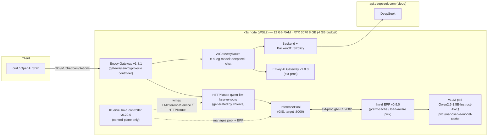
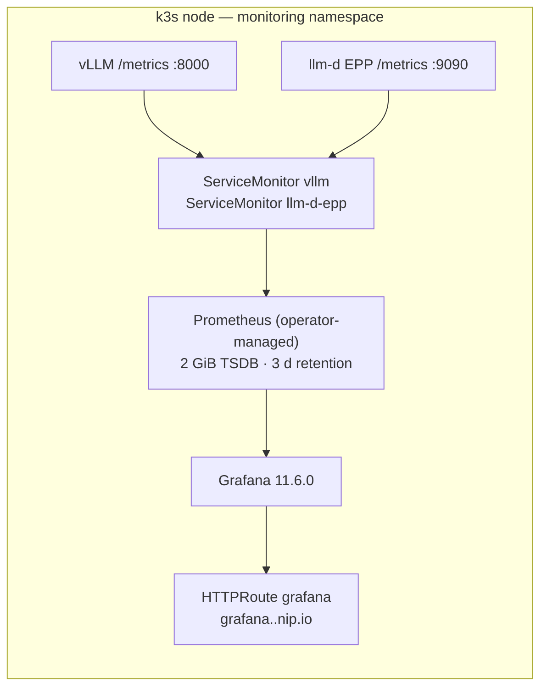

# NanoServe

A single-node **local inference stack**: KServe's `LLMInferenceService`
managing a vLLM engine (Qwen2.5-1.5B-Instruct-AWQ) on one constrained box —
12 GB RAM / 8 GB VRAM (RTX 3070) under WSL2 + k3s — with an optional cloud
(DeepSeek) tier behind the same gateway, plus load testing, DeepEval gates and
Prometheus/Grafana telemetry for that one node.

Built and verified end-to-end on 2026-09-07. This README states what the
repository does and what was measured on that box — nothing aspirational.

---

## Architecture



The KServe controller is **control-plane only** — it writes the
`LLMInferenceService` custom resource and lets the Gateway API data plane carry
traffic. There is no Knative/Istio.

- **Tier 1 (local):** `Envoy Gateway → InferencePool → llm-d EPP → vLLM pod`.
  The EPP picks the replica per request (prefix-cache / load-aware scoring).
- **Tier 2 (cloud):** requests carrying `x-ai-eg-model: deepseek-chat` are
  routed by Envoy AI Gateway to `api.deepseek.com` (TLS origination via a
  `BackendTLSPolicy`, API key injected via a `BackendSecurityPolicy`).

Telemetry (same node) — Prometheus Operator + `ServiceMonitor`s:



---

## Stack (what is actually deployed)

| Component | Version | Notes |
| --- | --- | --- |
| k3s (containerd, cgroup v2) | v1.36.3+k3s1 | single node, WSL2 |
| KServe `llm-d` controller | v0.20.0 | `LLMInferenceService` CRD, `kserve` ns |
| LeaderWorkerSet | v0.8.0 | controller `lws-system` |
| vLLM | llm-d-cuda `v0.8.0` | model `Qwen/Qwen2.5-1.5B-Instruct-AWQ`; `--gpu-memory-utilization 0.5` (`max-model-len 2048`) |
| Gateway API CRDs | v1.5.1 | `gateway.networking.k8s.io` |
| Envoy Gateway | v1.8.1 | GatewayClass / Gateway, `envoy-gateway-system` |
| Envoy AI Gateway | v1.0.0 | `AIGatewayRoute`, `AIServiceBackend`, `BackendSecurityPolicy`; `envoy-ai-gateway-system` |
| llm-d EPP | v0.9.0 | endpoint picker, ext-proc :9002, `kserve` ns |
| Prometheus Operator | kube-prometheus-stack v69.8.2 (operator v0.80.1) | `monitoring` ns, helm-managed |
| Prometheus | v3.2.1 (operator-managed CR) | 2 GiB local-path PVC, 3 d retention, scrapes `ServiceMonitor`s |
| Grafana | 11.6.0 | `monitoring` ns, provisioned datasource + dashboard |
| DeepSeek | — | cloud tier-2, reachable via gateway |

The full component-by-component manifest reference is in
[`manifests/README.md`](manifests/README.md); design notes and deviations from
the original plan are in [`Blueprint.md`](Blueprint.md).

---

## Measured results (2026-09-07, this box, via the gateway)

| What | Result |
| --- | --- |
| Tier-1 chat completion through gateway | HTTP 200 |
| Tier-2 DeepSeek through gateway (`x-ai-eg-model: deepseek-chat`) | HTTP 200 |
| Locust, 8 users / 2 min, via gateway | **355 requests, 0 failures**, ~3.0 req/s |
|   — latency p50 / p95 | 600 ms / 720 ms |
| Streaming benchmark via gateway (TTFT / ITL / throughput) | ~38 ms / ~15 ms / ~67 tok/s |
| DeepEval contract + G-Eval quality suite (self-judged) | pass |
| `infra/verify.sh` (phases 2–5 gate: fencing, GPU, gateway, LLMISVC, telemetry) | all checks pass |

Numbers are specific to this hardware/date — not a cross-hardware claim.

---

## Repository layout

```
├── src/nanoserve_llm/     # Python package: hardware fence (config.py), doctor CLI,
│                          #   telemetry adapter (telemetry.py)
├── manifests/             # Kubernetes: infra/ (gateway platform), serving/
│                          #   (LLMISVC, pool, EPP, DeepSeek tier), telemetry/
├── infra/                 # host scripts: verify.sh (gate), fetch-model.sh, k3s config
├── argo/                  # Argo CD install + app-of-apps (deferred — needs a Git remote)
├── evals/                 # pytest: endpoint contract + DeepEval G-Eval (e2e-gated)
├── load_tests/            # Locust suite → /v1/chat/completions
├── scripts/               # latency_benchmark.py, tracer.py
└── tests/                 # unit tests (config, telemetry, CLI)
```

## Quickstart (developer tooling)

```bash
uv sync                        # Python 3.12, dev group
uv run nanoserve-llm doctor    # sanity-check the hardware fence against this machine
make check                     # ruff, format, yaml checks, mypy, pytest
```

Cluster-facing targets (each idempotent; see `Makefile`):

```bash
make apply          # serving-plane manifests (LLMISVC, pool, EPP, tier-2)
make telemetry      # Prometheus + Grafana  (then: make secret-grafana)
make secret         # DeepSeek key → k8s Secret (reads gitignored .env)
make eval           # DeepEval suite via the gateway
make load           # Locust smoke via the gateway (8 users / 2 min)
make bench          # streaming TTFT/ITL benchmark via the gateway
make verify         # infra/verify.sh — full environment gate
```

Most targets resolve the gateway address from the cluster (`kubectl get gateway
kserve-gateway`) rather than hard-coding an IP.

## Environment

All settings are env-overridable (`NANOSERVE_*`) or via a local `.env`
(see [`.env.example`](.env.example)). Notable:

| Variable | Default | Purpose |
| --- | --- | --- |
| `NANOSERVE_SYSTEM_RAM_GB` | `12.0` | host RAM cap (also in `.wslconfig`) |
| `NANOSERVE_GPU_VRAM_GB` | `8.0` | GPU VRAM |
| `NANOSERVE_GPU_MEMORY_UTILIZATION` | `0.5` | vLLM memory fraction → 4 GB cap |
| `NANOSERVE_BASE_URL` | `http://localhost:8000/v1` | vLLM OpenAI-compatible endpoint (tooling defaults to the gateway when run via `make`) |
| `NANOSERVE_MODEL` | `Qwen/Qwen2.5-1.5B-Instruct-AWQ` | model in request payloads |
| `NANOSERVE_EVAL_LIVE` | `0` | `1` runs the e2e DeepEval tests |
| `DEEPSEEK_API_KEY` / `GRAFANA_ADMIN_PASSWORD` | — | gitignored secrets, applied via `make secret` / `make secret-grafana` |

## Verification

`infra/verify.sh` is the environment gate (exit 0 = all checks pass):

- host fencing (`.wslconfig`/swap/cgroup v2)
- k3s node Ready, NVIDIA runtime + `nvidia.com/gpu` capacity
- Gateway API stack + `LLMInferenceService` Ready, route `backendRefs` pointed
  at the InferencePool (group/kind), pool Accepted by the gateway
- gateway E2E chat 200
- Prometheus targets UP + KV-cache metric scraped; Grafana `/api/health` 200
  via the gateway

## Limitations / non-goals

- **Single node, one model.** The KV-cache budget is 4 GB
  (`gpu-memory-utilization 0.5`); `max-model-len 2048`. Scaling out is not in
  scope.
- **No embedding-based DeepEval metrics.** The eval suite is LLM-as-judge
  (`GEval`) only, so no torch / `sentence-transformers` dependency (keeps the
  lockfile light on this host).
- **`request-mirror-shadow.yaml` and `backendtrafficpolicy.yaml` are disabled.**
  The shadow route's path overlaps the KServe route; the traffic policy targets
  a route that was removed (see file headers + `manifests/README.md`).
- **Argo CD is installed but the app-of-apps is not applied** — it needs a
  published Git remote (`argo/install.sh` explains).
- **Grafana is served over plain HTTP on the LAN** via a hostname route
  (`grafana.<gateway>.nip.io`). No TLS/auth on the gateway itself.
- **Results above are environment-specific** (see "Measured results").
