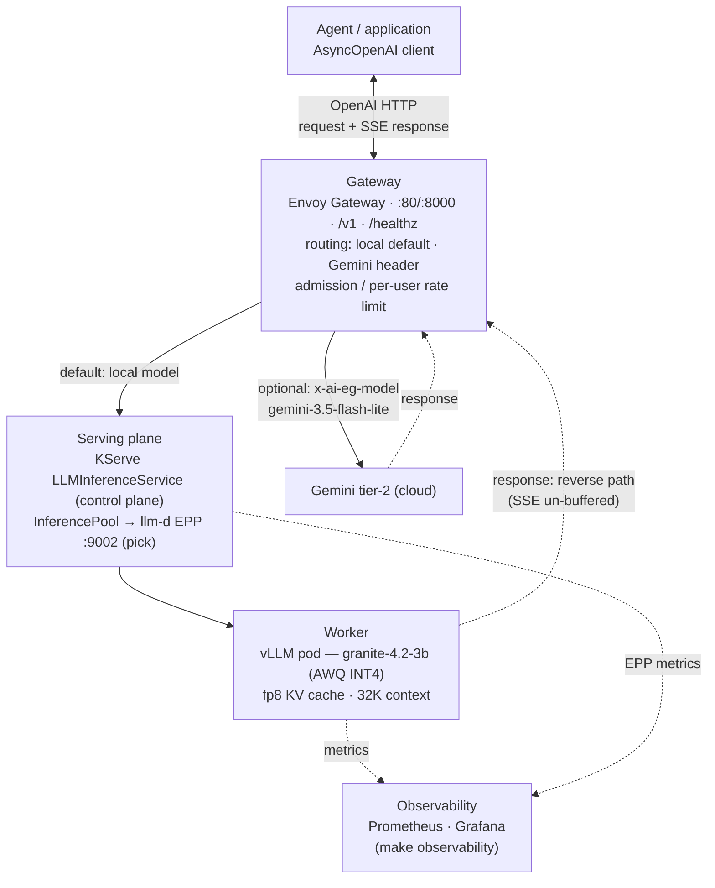

# NanoServe

Single-node **local LLM inference platform**: KServe's `LLMInferenceService`
managing vLLM (IBM Granite 4.2-3B — AutoRound AWQ INT4, 32K context, fp8 KV)
on one constrained box (12 GB RAM · RTX 3070 8 GB, WSL2 + k3s), with an
optional Google Gemini tier behind the same gateway. Verified end-to-end on
2026-09-08 — this README states what the repo does and what was measured on
that box, nothing aspirational.

**Consumed as an API, not code.** Integrated agents/applications (e.g. an
Arabic legal RAG agent on FastAPI + LangGraph) talk to the gateway over the
standard OpenAI protocol:

| | |
| --- | --- |
| API | `http://localhost:8000/v1` (same host) · `http://<gateway-LB>:8000/v1` (LAN) |
| Health probe | `GET /healthz` (gateway root; 200/empty body) |
| Model id | `ibm-granite/granite-4.2-3b` |
| Guide | [`docs/agent-integration.md`](docs/agent-integration.md) — setup, SSE, tools, thinking, resilience |
| Spec | [`contracts/openapi.yaml`](contracts/openapi.yaml) |
| Conformance | [`contract_tests/`](contract_tests/) — run `make contract-test` against any deployment |
| Dashboards | `make observability` → Grafana `:3000` + Prometheus `:9090` on localhost |

Do **not** send an `x-user-id` header (it opts into a 20 req/min per-user cap
used only by the load suite).

---

## Architecture

One k3s node runs everything below the Agent (this host is both
control-plane and worker — "one node", not a single-box HA claim).



Solid arrows are the request path; dashed arrows are the response or
observability path. For streaming, the response is an SSE stream over the same
connection, un-buffered by the gateway.

- **One k3s node (this host):** everything below the Agent runs on this host,
  which is a single k3s node that is both control-plane and worker. KServe is
  control-plane only: it writes the `LLMInferenceService` resource and lets
  the Gateway API data plane carry traffic (no Knative/Istio). Model weights
  are fetched host-side (`make download-model`) into the flat dir a static
  hostPath PV mounts — never in the pod.
- **Tier 1 (local):** Envoy Gateway → InferencePool → llm-d EPP (ext-proc
  `:9002`, prefix-cache/load-aware pick) → vLLM pod. A `BackendTrafficPolicy`
  sheds probabilistically (503s) if the engine fails under KV saturation; a
  second policy rate-limits per `x-user-id` (429 lever for the load suite).
- **Tier 2 (cloud):** requests with `x-ai-eg-model: gemini-3.5-flash-lite`
  are routed by Envoy AI Gateway to Google's OpenAI-compatible endpoint
  (`schema.prefix: /v1beta/openai`, `BackendTLSPolicy` System CA + SNI,
  `BackendSecurityPolicy` API-key injection).
- **Telemetry (same host):** vLLM `/metrics` + EPP `/metrics` are scraped via
  `ServiceMonitor`s into the operator-managed Prometheus (2 GiB TSDB, 3 d
  retention) and rendered in Grafana — `make observability` port-forwards both.

---

## Stack (what is actually deployed)

| Component | Version | Notes |
| --- | --- | --- |
| k3s (containerd, cgroup v2) | v1.36.3+k3s1 | single node, WSL2 |
| KServe `llm-d` controller | v0.20.0 | `LLMInferenceService` CRD, `kserve` ns |
| LeaderWorkerSet | v0.8.0 | controller `lws-system` |
| vLLM | llm-d-cuda `v0.8.0` | model `ibm-granite/granite-4.2-3b` (AutoRound AWQ INT4, awq_marlin); `--gpu-memory-utilization 0.80` (`max-model-len 32768`, fp8 KV ~97K tokens, `--enable-prefix-caching`, `--enable-auto-tool-choice --tool-call-parser qwen3_coder`, granite thinking parser) |
| Gateway API CRDs | v1.5.1 | `gateway.networking.k8s.io` |
| Envoy Gateway | v1.8.1 | GatewayClass / Gateway (`:80` + `:8000`), `envoy-gateway-system` |
| Envoy AI Gateway | v1.0.0 | `AIGatewayRoute`, `AIServiceBackend` (+ `schema.prefix`), `BackendSecurityPolicy`; `envoy-ai-gateway-system` |
| llm-d EPP | v0.9.0 | endpoint picker, ext-proc :9002, `kserve` ns |
| Prometheus Operator | kube-prometheus-stack v69.8.2 (operator v0.80.1) | `monitoring` ns, helm-managed |
| Prometheus | v3.2.1 (operator-managed CR) | 2 GiB local-path PVC, 3 d retention, scrapes `ServiceMonitor`s |
| Grafana | 11.6.0 | `monitoring` ns, provisioned datasource + dashboard |
| Google AI Studio (Gemini) | `gemini-3.5-flash-lite` | cloud tier-2 via `/v1beta/openai` |

The full component-by-component manifest reference is in
[`manifests/README.md`](manifests/README.md); design history and operational
lessons are in [`docs/blueprint.md`](docs/blueprint.md).

---

## Measured results (2026-09-08, this box, via the gateway)

| What | Result |
| --- | --- |
| Tier-1 chat completion through gateway (`ibm-granite/granite-4.2-3b`, AWQ INT4, 32K ctx, fp8 KV) | HTTP 200 |
| Tier-2 Gemini through gateway (`x-ai-eg-model: gemini-3.5-flash-lite`) | HTTP 200 |
| Gateway `/healthz` on :8000 (agent probe) | HTTP 200 |
| Reasoning: thinking on → `reasoning` + `content` fields; thinking off (`enable_thinking:false`) → clean content | verified |
| Saturation stress (shape: 20u plateau → 44u held spike, 3K-token RAG contexts, ~11 min) | **2,288 requests, 0 failures** |
|   — peak KV-cache usage / scheduler queue | **51%** / 28 waiting (16 running = `max-num-seqs`) |
|   — multi-turn p50 / p95 (deep queue at spike) | 4.0 s / 44 s |
|   — one-shot p50 / p95 | 1.3 s / 30 s |
| Clean 28-user spike (earlier run) | KV 46%, 31 waiting, p95 multi-turn 22 s |
| Streaming benchmark via gateway (Granite, thinking off) | TTFT ~59 ms / ITL ~23 ms / ~43 tok/s |
| DeepEval contract + G-Eval quality suite (self-judged, served Granite) | **9 passed** |
| Live agent contract suites (`make test-e2e`: healthz / Gemini-route / SSE / tool-calling) | **8 passed** |
| Hermetic unit + mocked contract tests (`make test-unit`) | 32 passed, 8 skipped (e2e-gated) |
| `infra/verify.sh` (phases 2–5 gate: fencing, GPU, gateway, LLMISVC, telemetry) | all checks pass |

> Data-plane note: the single-replica llm-d EPP ext-proc starts truncating request
> bodies above ~40 concurrent users (~30 req/s) → instant 400s (upstream pinned
> image). A single integrated agent (1–5 req/s) is far below this ceiling.

Numbers are specific to this hardware/date — not a cross-hardware claim.

---

## Repository layout

```
├── src/nanoserve_llm/     # Python package: hardware fence (config.py), doctor CLI,
│                          #   telemetry adapter (telemetry.py)
├── manifests/             # Kubernetes: infra/ (gateway platform), serving/
│                          #   (LLMISVC, pool, EPP, Gemini tier, healthz, CORS),
│                          #   telemetry/
├── infra/                 # host scripts: verify.sh (gate), k3s config
├── scripts/               # download_model.sh, latency_benchmark.py, tracer.py
├── argo/                  # Argo CD install + app-of-apps (deferred — needs a Git remote)
├── contracts/             # openapi.yaml — machine-readable API contract (agent codegen)
├── contract_tests/        # portable agent conformance suite (decoupled, env-driven)
├── docs/                  # agent-integration.md (consumer guide), blueprint.md (design history)
├── evals/                 # pytest: endpoint contract + DeepEval G-Eval (e2e-gated)
├── load_tests/            # Locust suite → /v1/chat/completions
└── tests/                 # unit tests (config, telemetry, CLI) + mocked agent
                           #   contract tests (respx) + tests/e2e (live, gated)
```

## Reproduce

One-time host setup (see `infra/README.md` for the WSL2/k3s memory fence):

```bash
make install-clis      # kubectl / helm / yq into ~/.local/bin (no root)
make bootstrap         # NVIDIA toolkit + k3s (root) — run once per host image
```

Model + secrets — the only external inputs:

```bash
make download-model    # ibm-granite/granite-4.2-3b AWQ INT4 -> host flat dir
                       # (idempotent; the AutoRound export may be produced
                       #  out-of-band — see scripts/download_model.sh)
export GEMINI_API_KEY=... && make secret          # Tier-2 cloud key (optional)
export GRAFANA_ADMIN_PASSWORD=... && make secret-grafana
```

Deploy + verify:

```bash
make apply            # serving-plane manifests (model, routes, tier-2, policies)
make telemetry        # Prometheus Operator + Grafana
make observability    # GUIs: Grafana http://localhost:3000 · Prometheus http://localhost:9090
make verify           # full environment gate (exit 0 = green)
```

Daily loop:

```bash
make check           # pre-commit gate (ruff / format / yaml / mypy / shellcheck / pytest)
make test-unit       # hermetic unit + mocked contract tests (no cluster)
make test-e2e        # live agent contract suites (needs the cluster on :8000)
make contract-test   # portable conformance suite (contract_tests/, decoupled)
make bench|eval|load|stress|trace   # measurements via the gateway
make help            # every target
```

Make targets resolve the gateway LB from the cluster dynamically — nothing is
hard-coded to an IP. The full env reference is in `.env.example`.

## Configuration

Defaults are tuned to this box and live in `src/nanoserve_llm/config.py`;
every value is overridable via `NANOSERVE_*` env vars or a local `.env`
(copy [`.env.example`](.env.example)). The ones you touch often:

| Variable | Default | Purpose |
| --- | --- | --- |
| `NANOSERVE_BASE_URL` | `http://localhost:8000/v1` | agent API surface |
| `NANOSERVE_MODEL` | `ibm-granite/granite-4.2-3b` | model in request payloads |
| `NANOSERVE_GPU_MEMORY_UTILIZATION` | `0.80` | vLLM VRAM fraction → ~6.4 GB cap |
| `GEMINI_API_KEY` | — | exported; `make secret` applies the Tier-2 Secret |
| `GRAFANA_ADMIN_PASSWORD` | — | exported; `make secret-grafana` applies the admin Secret |
| `HF_ENDPOINT` | — | mirror fallback for `make download-model` (e.g. `https://hf-mirror.com`) |
| `NANOSERVE_{EVAL,E2E,CONTRACT}_LIVE` | `0` | set `1` to run the live-gated suites |

## Verification

`infra/verify.sh` is the environment gate (exit 0 = all checks pass):

- host fencing (`.wslconfig`/swap/cgroup v2)
- k3s node Ready, NVIDIA runtime + `nvidia.com/gpu` capacity
- Gateway API stack + `LLMInferenceService` Ready, route `backendRefs` pointed
  at the InferencePool (group/kind), pool Accepted by the gateway
- model PV bound + hostPath populated, gateway E2E chat 200 (granite model echo)
- `/healthz` 200 on :8000, CORS preflight allowed, Gemini AIServiceBackend
  Accepted, local admission-control + rate-limit policies present
- Prometheus targets UP + KV-cache metric scraped; Grafana `/api/health` 200
  via the gateway (`make observability` exposes both GUIs on localhost)

## Limitations / non-goals

- **Single node, one model.** The VRAM budget is ~6.4 GB
  (`gpu-memory-utilization 0.80`); `max-model-len 32768` (fp8 KV pool ~97K
  tokens is fixed by the memory budget). Scaling out is not in scope.
- **No embedding-based DeepEval metrics.** The eval suite is LLM-as-judge
  (`GEval`) only, so no torch / `sentence-transformers` dependency (keeps the
  lockfile light on this host).
- **`request-mirror-shadow.yaml` is disabled.** The shadow route's path
  overlaps the KServe route (see file header + `manifests/README.md`).
- **Argo CD is installed but the app-of-apps is not applied** — it needs a
  published Git remote (`argo/install.sh` explains).
- **Grafana/Prometheus are reached by port-forward** (`make observability` →
  `localhost:3000` / `localhost:9090`). An optional LAN hostname route exists
  (`grafana-route.yaml`) but its hostname must be re-pointed at the current
  gateway LB after host restarts (nip.io convenience, no TLS).
- **Tool parsing uses `qwen3_coder`** — the pinned runtime vLLM build has no
  native `qwen25` parser (verified in-cluster); `qwen3_coder` is the
  IBM-recommended parser for Granite 4.2 and is present in the runtime.
  Reasoning is split into a `reasoning` field by the granite_thinking_parser
  plugin (request-controlled via `enable_thinking`).
- **Results above are environment-specific** (see "Measured results").
