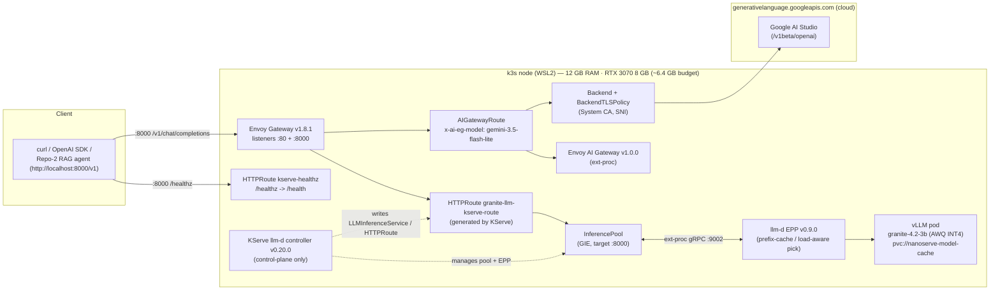
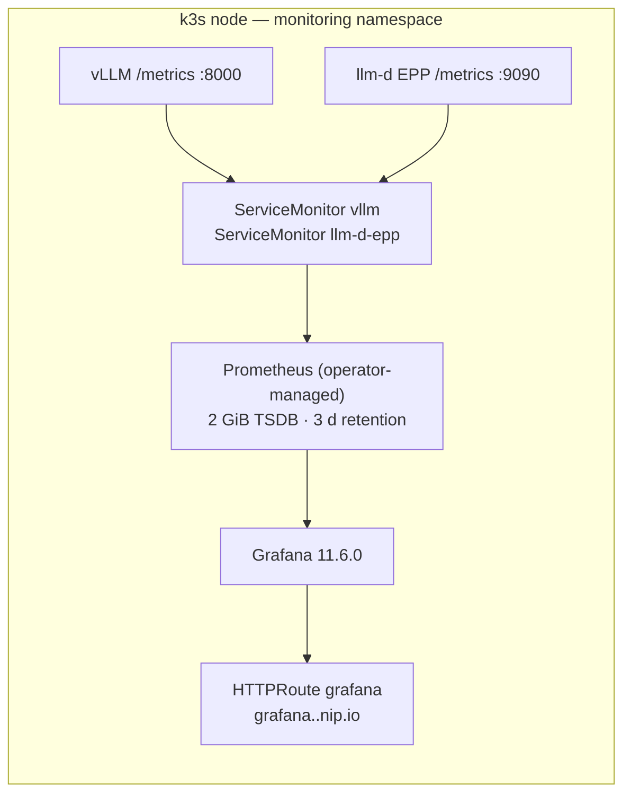

# NanoServe

A single-node **local inference stack**: KServe's `LLMInferenceService`
managing a vLLM engine (ibm-granite/granite-4.2-3b — AWQ INT4) on one constrained box —
12 GB RAM / 8 GB VRAM (RTX 3070) under WSL2 + k3s — with an optional cloud
(Google AI Studio / Gemini) tier behind the same gateway, plus load testing,
hermetic CI, live Repository-2 contract suites and Prometheus/Grafana
telemetry for that one node.

The gateway exposes an **immutable OpenAI-compatible contract** for downstream
applications (e.g. the Arabic Legal RAG Agent) at `http://localhost:8000/v1`
with `/healthz`, SSE streaming and tool-calling.

Built and verified end-to-end on 2026-09-08. This README states what the
repository does and what was measured on that box — nothing aspirational.

---

## Repository 2 integration (API/platform contract)

This repository is consumed **as an external API platform** — no shared code or
coupling. Repository 2 (Arabic Legal RAG Agent, FastAPI + LangGraph, asyncio)
needs only a base URL + the model id and the standard `AsyncOpenAI` client:

- **Contract doc** (authoritative handoff): [`docs/repo2-api-contract.md`](docs/repo2-api-contract.md)
- **OpenAPI spec**: [`contracts/openapi.yaml`](contracts/openapi.yaml)
- **Portable conformance suite** (env-driven, decoupled): [`contract_tests/`](contract_tests/)
  — run it against any deployment with `make contract-test` (or directly via
  `NANOSERVE_CONTRACT_LIVE=1 pytest contract_tests -v`)

Surface: `POST /v1/chat/completions` (non-stream + SSE), `GET /v1/models`,
health probe at `GET /healthz` (root URL, 200/empty). Model:
`ibm-granite/granite-4.2-3b`. Thinking is request-controlled via
`chat_template_kwargs.enable_thinking`; tool calling is OpenAI-schema
(qwen3_coder); Arabic works end to end (verified). Base URL is configurable:
`http://localhost:8000/v1` (same host) or `http://<gateway-LB>:8000/v1` (LAN).
Do **not** send `x-user-id` (that header opts into a 20 req/min per-user cap).

---

## Architecture



The KServe controller is **control-plane only** — it writes the
`LLMInferenceService` custom resource and lets the Gateway API data plane carry
traffic. There is no Knative/Istio.

- **Tier 1 (local):** `Envoy Gateway → InferencePool → llm-d EPP → vLLM pod`.
  The EPP picks the replica per request (prefix-cache / load-aware scoring).
  `BackendTrafficPolicy kserve-admission-control-local` sheds probabilistically
  if the local model starts failing under KV saturation.
- **Tier 2 (cloud):** requests carrying `x-ai-eg-model: gemini-3.5-flash-lite`
  are routed by Envoy AI Gateway to Google's OpenAI-compatible endpoint
  (`schema.prefix: /v1beta/openai`, TLS origination via a `BackendTLSPolicy`,
  API key injected via a `BackendSecurityPolicy`). No traffic policy on this
  route — the downstream agent rate-limits client-side.

Model weights never download in the pod: `scripts/download_model.sh`
(`make download-model`) fetches them into the host HuggingFace cache and
materializes a flat dir mounted through a static hostPath PV.

Telemetry (same node) — Prometheus Operator + `ServiceMonitor`s:



---

## Stack (what is actually deployed)

| Component | Version | Notes |
| --- | --- | --- |
| k3s (containerd, cgroup v2) | v1.36.3+k3s1 | single node, WSL2 |
| KServe `llm-d` controller | v0.20.0 | `LLMInferenceService` CRD, `kserve` ns |
| LeaderWorkerSet | v0.8.0 | controller `lws-system` |
| vLLM | llm-d-cuda `v0.8.0` | model `ibm-granite/granite-4.2-3b` (AutoRound AWQ INT4, awq_marlin); `--gpu-memory-utilization 0.80` (`max-model-len 32768`, fp8 KV ~97K tokens, `--enable-prefix-caching`, `--enable-auto-tool-choice --tool-call-parser qwen3_coder`, granite thinking parser) |
| Gateway API CRDs | v1.5.1 | `gateway.networking.k8s.io` |
| Envoy Gateway | v1.8.1 | GatewayClass / Gateway (`:80` + `:8000`), `envoy-gateway-system` |
| Envoy AI Gateway | v1.0.0 | `AIGatewayRoute`, `AIServiceBackend` (+ `schema.prefix`), `BackendSecurityPolicy`; `envoy-ai-gateway-system` |
| llm-d EPP | v0.9.0 | endpoint picker, ext-proc :9002, `kserve` ns |
| Prometheus Operator | kube-prometheus-stack v69.8.2 (operator v0.80.1) | `monitoring` ns, helm-managed |
| Prometheus | v3.2.1 (operator-managed CR) | 2 GiB local-path PVC, 3 d retention, scrapes `ServiceMonitor`s |
| Grafana | 11.6.0 | `monitoring` ns, provisioned datasource + dashboard |
| Google AI Studio (Gemini) | `gemini-3.5-flash-lite` | cloud tier-2 via `/v1beta/openai` |

The full component-by-component manifest reference is in
[`manifests/README.md`](manifests/README.md); design notes and deviations from
the original plan are in [`Blueprint.md`](Blueprint.md).

---

## Measured results (2026-09-08, this box, via the gateway)

| What | Result |
| --- | --- |
| Tier-1 chat completion through gateway (`ibm-granite/granite-4.2-3b`, AWQ INT4, 32K ctx, fp8 KV) | HTTP 200 |
| Tier-2 Gemini through gateway (`x-ai-eg-model: gemini-3.5-flash-lite`) | HTTP 200 |
| Gateway `/healthz` on :8000 (Repository-2 probe) | HTTP 200 |
| Reasoning: thinking on → `reasoning` + `content` fields; thinking off (`enable_thinking:false`) → clean content | verified |
| Saturation stress (shape: 20u plateau → 44u held spike, 3K-token RAG contexts, ~11 min) | **2,288 requests, 0 failures** |
|   — peak KV-cache usage / scheduler queue | **51%** / 28 waiting (16 running = `max-num-seqs`) |
|   — multi-turn p50 / p95 (deep queue at spike) | 4.0 s / 44 s |
|   — one-shot p50 / p95 | 1.3 s / 30 s |
| Clean 28-user spike (earlier run) | KV 46%, 31 waiting, p95 multi-turn 22 s |
| Streaming benchmark via gateway (Granite, thinking off) | TTFT ~59 ms / ITL ~23 ms / ~43 tok/s |
| DeepEval contract + G-Eval quality suite (self-judged, served Granite) | **9 passed** |
| Live Repo-2 contract suites (`make test-e2e`: healthz / Gemini-route / SSE / tool-calling) | **8 passed** |
| Hermetic unit + mocked contract tests (`make test-unit`) | 32 passed, 8 skipped (e2e-gated) |
| `infra/verify.sh` (phases 2–5 gate: fencing, GPU, gateway, LLMISVC, telemetry) | all checks pass |

> Data-plane note: the single-replica llm-d EPP ext-proc starts truncating request
> bodies above ~40 concurrent users (~30 req/s) → instant 400s (upstream pinned
> image). Repo-2's single-agent traffic (1–5 req/s) is far below this ceiling.

Numbers are specific to this hardware/date — not a cross-hardware claim.

---

## Repository layout

```
├── src/nanoserve_llm/     # Python package: hardware fence (config.py), doctor CLI,
│                          #   telemetry adapter (telemetry.py)
├── manifests/             # Kubernetes: infra/ (gateway platform), serving/
│                          #   (LLMISVC, pool, EPP, Gemini tier, healthz, CORS),
│                          #   telemetry/
├── infra/                 # host scripts: verify.sh (gate), k3s config
├── scripts/               # download_model.sh, latency_benchmark.py, tracer.py
├── argo/                  # Argo CD install + app-of-apps (deferred — needs a Git remote)
├── contracts/             # openapi.yaml — machine-readable API contract (Repo-2 codegen)
├── contract_tests/        # portable Repo-2 conformance suite (decoupled, env-driven)
├── docs/                  # repo2-api-contract.md — authoritative integration guide
├── evals/                 # pytest: endpoint contract + DeepEval G-Eval (e2e-gated)
├── load_tests/            # Locust suite → /v1/chat/completions
└── tests/                 # unit tests (config, telemetry, CLI) + mocked Repo-2
                           #   contract tests (respx) + tests/e2e (live, gated)
```

## Quickstart (developer tooling)

```bash
uv sync                        # Python 3.12, dev group
uv run nanoserve-llm doctor    # sanity-check the hardware fence against this machine
make check                     # ruff, format, yaml checks, mypy, pytest
make test-unit                 # hermetic unit + mocked contract tests (no cluster)
```

Cluster-facing targets (each idempotent; see `Makefile`):

```bash
make download-model # model weights → host HF cache + flat dir (hostPath PV)
make apply          # serving-plane manifests (LLMISVC, pool, EPP, tier-2, healthz)
make secret         # Gemini key → k8s Secret (reads gitignored .env)
make test-e2e       # live Repo-2 contract suites (gate: /healthz on :8000)
make contract-test  # portable conformance suite (contract_tests/, env-driven)
make eval           # DeepEval suite via the gateway
make load           # Locust smoke via the gateway (8 users / 2 min)
make bench          # streaming TTFT/ITL benchmark via the gateway
make verify         # infra/verify.sh — full environment gate
```

Most targets resolve the gateway address from the cluster (`kubectl get gateway
kserve-gateway`) rather than hard-coding an IP. The Repository-2 base URL
(`http://localhost:8000/v1`) is served by the gateway's `:8000` listener.

## Environment

All settings are env-overridable (`NANOSERVE_*`) or via a local `.env`
(see [`.env.example`](.env.example)). Notable:

| Variable | Default | Purpose |
| --- | --- | --- |
| `NANOSERVE_SYSTEM_RAM_GB` | `12.0` | host RAM cap (also in `.wslconfig`) |
| `NANOSERVE_GPU_VRAM_GB` | `8.0` | GPU VRAM |
| `NANOSERVE_GPU_MEMORY_UTILIZATION` | `0.80` | vLLM memory fraction → ~6.4 GB cap |
| `NANOSERVE_BASE_URL` | `http://localhost:8000/v1` | OpenAI-compatible endpoint (tooling defaults to the gateway when run via `make`) |
| `NANOSERVE_MODEL` | `ibm-granite/granite-4.2-3b` | model in request payloads |
| `NANOSERVE_EVAL_LIVE` | `0` | `1` runs the e2e DeepEval tests |
| `NANOSERVE_E2E_LIVE` | `0` | `1` runs the live Repo-2 contract suites (`tests/e2e`) |
| `NANOSERVE_CONTRACT_LIVE` | `0` | `1` runs the portable conformance suite (`contract_tests/`) |
| `GEMINI_API_KEY` / `GRAFANA_ADMIN_PASSWORD` | — | gitignored secrets, applied via `make secret` / `make secret-grafana` |
| `HF_ENDPOINT` | — | mirror fallback for `make download-model` (e.g. `https://hf-mirror.com`) |

## Verification

`infra/verify.sh` is the environment gate (exit 0 = all checks pass):

- host fencing (`.wslconfig`/swap/cgroup v2)
- k3s node Ready, NVIDIA runtime + `nvidia.com/gpu` capacity
- Gateway API stack + `LLMInferenceService` Ready, route `backendRefs` pointed
  at the InferencePool (group/kind), pool Accepted by the gateway
- model PV bound + hostPath populated, gateway E2E chat 200 (3B model echo)
- `/healthz` 200 on :8000, CORS preflight allowed, Gemini AIServiceBackend
  Accepted, local admission-control policy present
- Prometheus targets UP + KV-cache metric scraped; Grafana `/api/health` 200
  via the gateway

## Limitations / non-goals

- **Single node, one model.** The VRAM budget is ~6.4 GB
  (`gpu-memory-utilization 0.80`); `max-model-len 32768` (fp8 KV pool ~97K
  tokens is fixed by the memory budget). Scaling out is not in scope.
- **No embedding-based DeepEval metrics.** The eval suite is LLM-as-judge
  (`GEval`) only, so no torch / `sentence-transformers` dependency (keeps the
  lockfile light on this host).
- **`request-mirror-shadow.yaml` is disabled.** The shadow route's path
  overlaps the KServe route (see file header + `manifests/README.md`).
- **Argo CD is installed but the app-of-apps is not applied** — it needs a
  published Git remote (`argo/install.sh` explains).
- **Grafana is served over plain HTTP on the LAN** via a hostname route
  (`grafana.<gateway>.nip.io`). No TLS/auth on the gateway itself (CORS is
  permissive — local dev surface only).
- **Tool parsing uses `qwen3_coder`** — the pinned runtime vLLM build has no
  native `qwen25` parser (verified in-cluster); `qwen3_coder` is the
  IBM-recommended parser for Granite 4.2 and is present in the runtime.
  Reasoning is split into a `reasoning` field by the granite_thinking_parser
  plugin (request-controlled via `enable_thinking`).
- **Results above are environment-specific** (see "Measured results").
